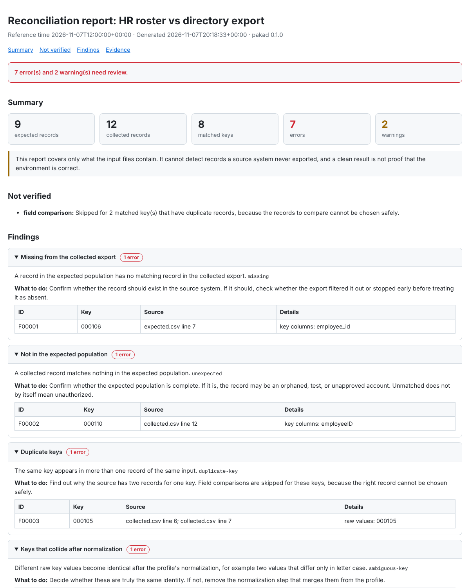

# pakad

**Evidence Population Reconciler.** Reconcile an expected population against a collected evidence export. See exactly what is missing, extra, duplicated, ambiguous, or stale, with every finding traced back to its source row.

[](https://github.com/faithful-oversight/faithful-pakad/actions/workflows/ci.yml)
[](LICENSE)



## Why pakad

Audit evidence often starts with two lists: who *should* be there, such as an HR roster or an approved access list, and what a system export *says* is there. Comparing them by hand in a spreadsheet is slow, easy to get wrong, and hard to defend. Leading zeros vanish, duplicates hide, a paged export silently stops at 1,000 rows, and nobody can say afterward which files the conclusion came from.

pakad does the comparison the same way every time and writes a report an assessor can rely on:

- **Missing and unexpected records**, matched on the key columns you choose.
- **Duplicate and ambiguous keys**, including values that only collide after normalization, such as `A0108` and `a0108`.
- **Field mismatches** on matched records, with equivalents, so `TRUE` can count as `active`.
- **Collection problems:** expected sources with no records, stale capture times, and counts that suggest a paged export stopped early.
- **What it could not verify**, stated in every report rather than left out.
- **Evidence details**, including SHA-256 hashes of every input and the profile, the rules applied, the reference time, and the tool version.

## About the name

*pakad* (pah-KAHD). Hebrew *paqad*: to number, to muster, to account for, and to notice who is missing.

## Install

pakad needs Python 3.11 or newer and has no runtime dependencies.

```shell
pipx install faithful-pakad
```

Until the first release reaches PyPI, install from a release's wheel file or from source:

```shell
pipx install ./faithful_pakad-0.1.1-py3-none-any.whl
```

## Try it in one minute

```shell
pakad example ./pakad-demo
pakad reconcile -p ./pakad-demo/profile.toml -e ./pakad-demo/expected.csv \
  -c ./pakad-demo/collected.csv -o ./pakad-demo/report --as-of 2026-11-07T12:00:00Z
```

Open `./pakad-demo/report/pakad-report.html` in any browser. The example data is synthetic and shows every kind of finding. The same reports are committed in [examples/roster-vs-directory/sample-report](examples/roster-vs-directory/sample-report/).

## Use it on your own data

1. Export the expected population and the collected evidence as CSV or JSON.
2. Write a profile that names the key columns and the checks you want. Start from `pakad example-profile > profile.toml`, then see the [profile reference](docs/profile.md).
3. Check it with `pakad check-profile profile.toml`.
4. Run `pakad reconcile` and open the HTML report.

## Outputs

| File | For |
| --- | --- |
| `pakad-report.html` | People. One self-contained page that works offline in any browser, in light or dark mode, and prints cleanly. |
| `pakad-report.json` | Automation. Follows a published, versioned [JSON Schema](src/faithful_pakad/schema/report-v1.schema.json). |
| `pakad-findings.csv` | Spreadsheets and ticketing. Protected against formula injection. |
| `pakad-report.md` | Pull requests, tickets, and change records. |
| `pakad-manifest.json` | Evidence handling. The run ID and the SHA-256 of every other report file, written last. |

Exit codes make pakad easy to use in pipelines: `0` no findings, `1` findings, `2` usage error, `3` input or output error, and `4` an internal error, so a crash is never mistaken for findings. Use `--fail-on error` to pass when there are only warnings.

## Design principles

- **Read-only and offline.** pakad reads files you give it and writes reports. It never connects to a network or changes a system.
- **Text, not guesses.** Every value stays text, so identifiers keep their leading zeros and formatting.
- **Explicit rules.** Normalization and comparisons happen only as the profile says, and each report lists the rules applied.
- **Explicit unknowns.** A check that did not run is reported as not verified, never as passed.
- **Safe output.** Reports escape every input value, and the HTML page cannot run scripts or load anything.

## Documentation

- [Quickstart](docs/quickstart.md)
- [Command reference](docs/usage.md)
- [Profile reference](docs/profile.md)
- [Reports and findings](docs/output.md)
- [Guide for assessors](docs/assessors.md)
- [Limitations](docs/limitations.md)
- [Architecture](docs/architecture.md) and [threat model](docs/threat-model.md)
- [Releasing](docs/releasing.md) and [decision records](docs/adr/)

## Security

Please do not report security problems in public issues. See [SECURITY.md](SECURITY.md).

## Contributing

Contributions are welcome. Read [CONTRIBUTING.md](CONTRIBUTING.md) and the [code of conduct](CODE_OF_CONDUCT.md) first.

## License

Copyright 2026 Faithful Oversight, LLC. Licensed under the [Apache License, Version 2.0](LICENSE).
